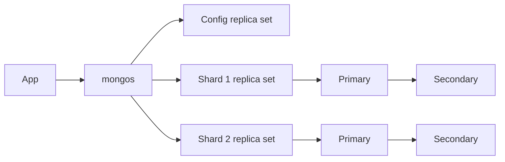

# Task 13: Sharding plus replication
In MongoDB, a router (`mongos`) directs requests by shard key; each shard is a replica set, and config servers store metadata as a replica set. This is a design/demo checklist, not a claim that the base Compose stack is distributed.

Checklist: choose a high-cardinality key; create the sharded collection; verify `sh.status()`; insert and locate records on shards; stop a secondary and observe health; stop a primary and verify election. Cassandra combines partitioning and replication in its peer-to-peer ring rather than using a router.
