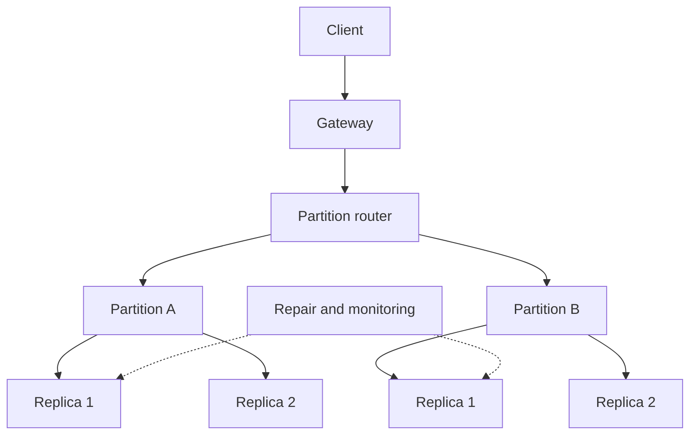

# Task 15: Architecture and distribution-model study

| Model | Distribution | Failure handling | Advantage | Limitation | Application |
|---|---|---|---|---|---|
| Sharding | Hash/range routes records | Rebalance and replace failed replicas | Horizontal scale | Hot keys and cross-shard queries | Global attendance |
| Replication | Copies data to nodes | Election, quorum, repair | Availability/read locality | Write cost and stale reads | Student profiles |
| Peer-to-peer ring | Token ownership among equal nodes | Gossip, hinted handoff, repair | No primary bottleneck | Query-first modelling | Attendance events |
| Graph distribution | Related nodes/edges routed | Cluster recovery | Natural relationship queries | Cross-partition traversal cost | Prerequisite graph |

Failure scenarios: a failed replica is replaced and repaired; a failed leader is elected and clients retry idempotently; a network partition requires an explicit consistency/availability choice; a hot shard requires a better key or chunk movement.

Partition by the most frequent query key, replicate according to availability needs, and test failure behavior rather than inferring it from configuration.
